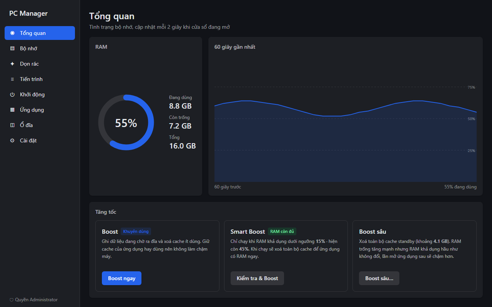
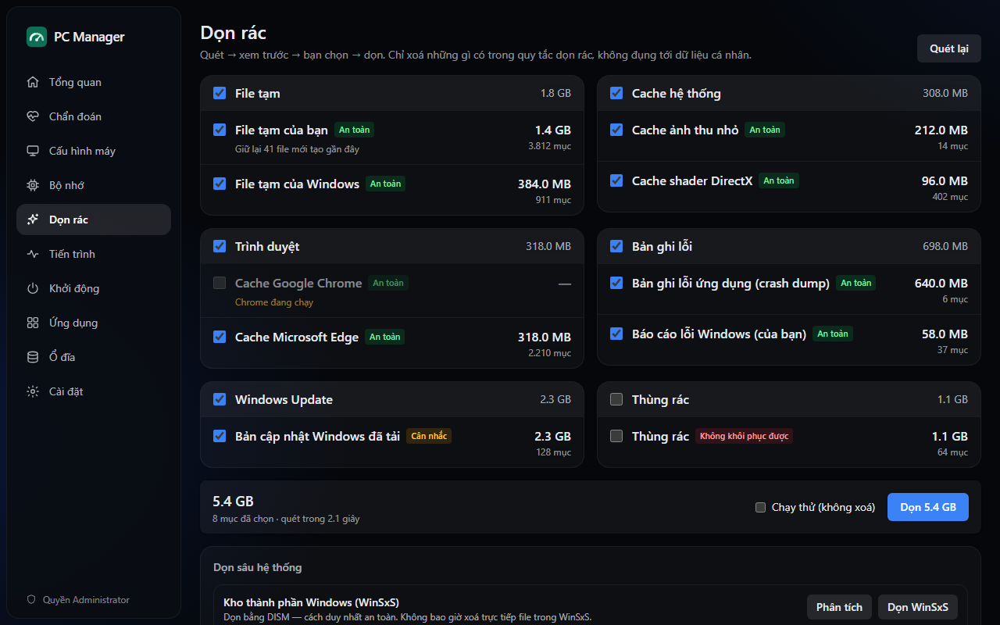
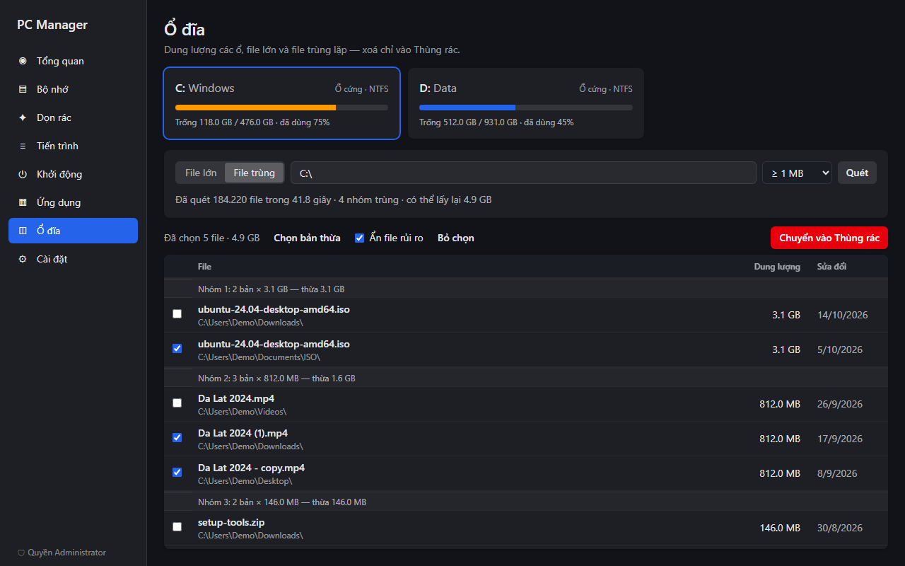
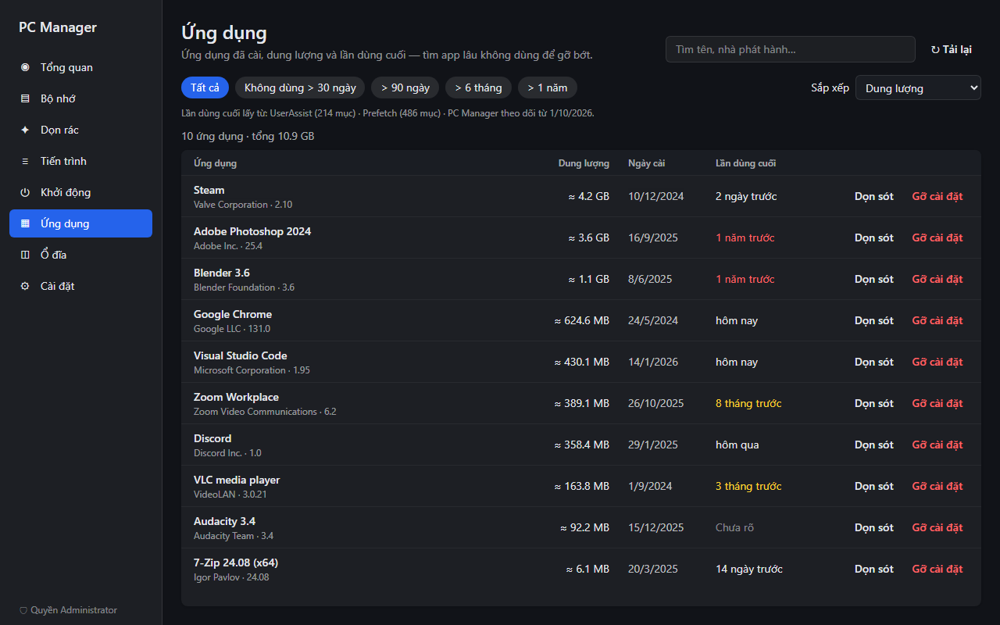
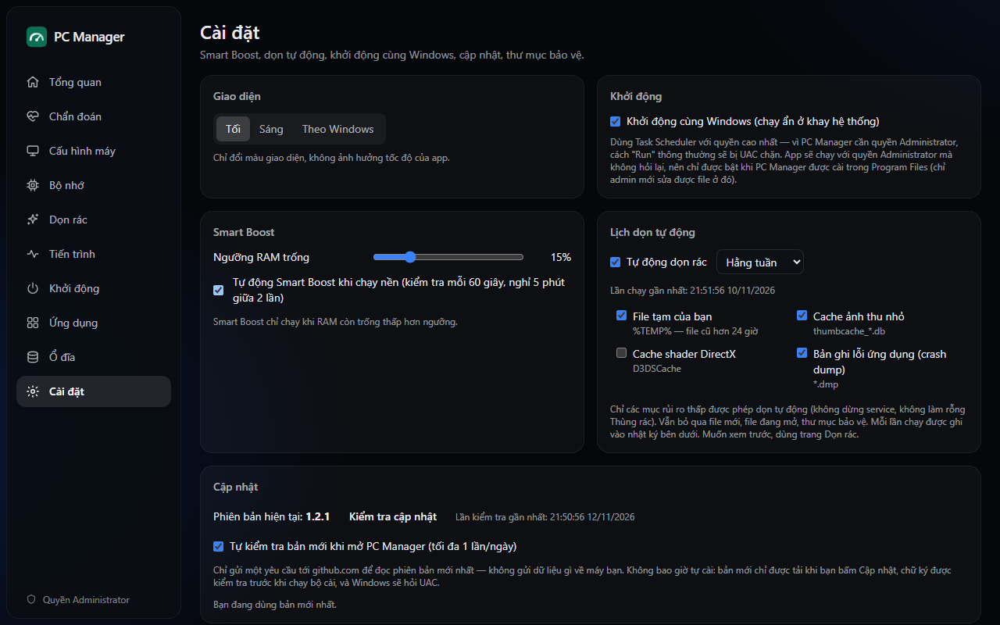

<div align="center">


# PC Manager

**軽量で安全性を最優先した Windows 10/11 向けメンテナンスツール。**

メモリの監視、不要ファイルの削除、プロセスとスタートアップの管理、使っていないアプリ・<br>
大きなファイル・重複ファイルの検出 — インストーラーは 2.5 MB、常駐時のメモリは数 MB です。

[](https://github.com/bachxuantrann/pc-manager/releases/latest)
[](https://github.com/bachxuantrann/pc-manager/actions/workflows/ci.yml)
[](#ライセンス)


[English](README.md) · [Tiếng Việt](README.vi.md) · [简体中文](README.zh-CN.md) · **日本語**

</div>



> アプリの画面は現在ベトナム語です。このページはドキュメントの日本語訳です。

## 目次

- [特長](#特長)
- [機能](#機能)
- [インストール](#インストール)
- [管理者権限](#管理者権限)
- [安全性](#安全性)
- [メモリ Boost の仕組み](#メモリ-boost-の仕組み)
- [よくある質問](#よくある質問)
- [ソースからのビルド](#ソースからのビルド)
- [ライセンス](#ライセンス)

## 特長

- **軽量。** インストーラーは約 2.5 MB。タスクトレイ常駐時のメモリ使用量は約 2〜15 MB で、
  ウィンドウを閉じると UI エンジンは完全に解放されます。
- **安全を前提とした設計。** 固定ルールに一致するものだけを削除し、必ず事前にプレビューします。
  手動で選んだファイルはごみ箱に移すだけで、すべての変更は記録されます。
- **起動時に UAC を要求しない。** 標準ユーザーとして動作し、機能が本当に必要とするときだけ昇格を求めます。
- **正直な表示。** 誇張した「解放量」ではなく、各操作の実際の効果を表示します。

## 機能

| 項目 | 内容 |
|---|---|
| **ダッシュボードとメモリ** | メモリ使用量、利用可能メモリ、スタンバイ、60 秒の履歴グラフ。Boost、Smart Boost、ディープ Boost |
| **不要ファイルの削除** | 一時ファイル、ブラウザーキャッシュ、クラッシュダンプ、ログ、Windows Update キャッシュ、ごみ箱。削除前のプレビューとドライラン。DISM による WinSxS のクリーンアップ、ディスククリーンアップによる `Windows.old` の削除 |
| **プロセス** | プロセスごとの CPU とメモリ、発行元（デジタル署名）、終了、一時停止/再開、優先度、ワーキングセットの縮小、ファイルの場所を開く |
| **スタートアップ** | レジストリ、スタートアップフォルダー、タスクスケジューラ、サービス。タスクマネージャーと同じ方法で有効化/無効化 |
| **インストール済みアプリ** | サイズ、インストール日、最終使用日。何か月も使っていないアプリの絞り込み。アンインストール後の残りファイルの削除 |
| **ディスク** | 各ドライブの使用量、最大のファイル、内容が同一の重複ファイル（BLAKE3）。ごみ箱へ移動 |
| **設定** | Smart Boost のしきい値、定期クリーンアップ、Windows と同時に起動、保護フォルダー、操作ログ |

<table>
  <tr>
    <td></td>
    <td></td>
  </tr>
  <tr>
    <td></td>
    <td></td>
  </tr>
</table>

<sub>スクリーンショットはデモデータを使用しており、実際の PC のデータではありません。</sub>

## インストール

1. [最新リリース](https://github.com/bachxuantrann/pc-manager/releases/latest)から
   `PC-Manager_<バージョン>_x64-setup.exe` をダウンロードします。
2. インストーラーを実行します。`Program Files` にインストールされ、管理者の承認を一度求められます。
3. インストーラーは**自己署名証明書**で署名されており、Windows が信頼する認証局の証明書ではないため、
   Microsoft Defender SmartScreen が *"Windows protected your PC"* と表示することがあります。
   **More info → Run anyway** を選択してください。各リリースにはインストーラーの SHA-256 が記載されています。
   [ソースからビルド](#ソースからのビルド)することもできます。

**動作環境：** Windows 10 または 11（x64）と Microsoft Edge WebView2 Runtime（Windows 11 には標準搭載。
ない場合はインストーラーが自動でダウンロードします）。

**更新：** 新しいインストーラーを上書きで実行します。設定と操作ログは保持されます。
**アンインストール：** 他のアプリと同様に *設定 → アプリ* から行います。Windows と同時に起動するタスクを
有効にしていた場合は、それも削除されます。

## 管理者権限

| 起動方法 | 権限 |
|---|---|
| 通常の起動 | 標準ユーザー、UAC は表示されません |
| **管理者として実行**ボタン（サイドバー、または権限が必要な機能の横） | UAC で承認後に管理者権限。同じページで再起動します |
| Windows と同時に起動（任意） | 確認なしで管理者権限 — アプリが `Program Files` にインストールされている場合のみ有効化できます |

管理者権限が必要な機能：メモリ Boost、システムの場所の削除（`Windows\Temp`、システムのクラッシュダンプ、
Windows Update キャッシュ）、Prefetch の読み取り、全ユーザー共通のスタートアップ項目の変更、システムプロセスの操作、
全ユーザー向けアプリのアンインストール、WinSxS のクリーンアップ。それ以外は昇格なしで使えます。

## 安全性

PC Manager はファイル、プロセス、レジストリ、サービスを扱うため、削除につながる処理はすべてコード上で保護されています。
以下は概要です。詳細は **[docs/SAFETY.md](docs/SAFETY.md)**（英語）を参照してください。

- **ルールに基づく削除のみ。** [`rules/cleaner.toml`](rules/cleaner.toml) の固定ルールに一致するファイルだけを削除します。
  ルールはビルド時にアプリへ組み込まれ、UI から任意のパスを受け取って削除するコマンドはありません。
- **スキャン → プレビュー → 確認 → 削除**。ドライランにも対応しています。
- シンボリックリンク、ジャンクション、再解析ポイントを**たどりません**。ロック中のファイル、ルールの経過時間より新しいファイル、
  スキャン後に変更されたファイルはスキップします。
- **削除禁止リスト：** `System32`、`SysWOW64`、`WinSxS`（DISM 経由でのみ削除）、`Prefetch`、ユーザープロファイルのルート、
  個人用フォルダー（ドキュメント、デスクトップ、ピクチャ…）、`Program Files`、すべてのドライブのルート。
  独自の**保護フォルダー**も追加できます。
- **完全削除ではなくごみ箱へ：** 大きなファイル、重複ファイル、アプリのアンインストール後に残ったファイルが対象です。
  レジストリキーは削除前に `.reg` ファイルへバックアップされます。
- **重要なプロセスを保護**（`csrss`、`wininit`、`winlogon`、`lsass`、`smss`、`services`、System）。
  スタートアップ項目を無効にしても元の項目は削除しません。
- **すべての変更をローカルに記録**し、*設定 → 操作ログ* で確認できます。
- **テスト済み。** 削除対象の選択ロジックに対するサンドボックステスト（ジャンクション、ロック中のファイル、新しいファイル、
  禁止フォルダー、スキャン後に変更されたファイル）を含む 140 以上の自動テストが、プッシュのたびに実行されます。

セキュリティ上の問題の報告方法は [SECURITY.md](SECURITY.md) を参照してください。

## メモリ Boost の仕組み

Windows はもともとメモリを上手に管理しているため、PC Manager は「魔法のような高速化」を約束しません。

- **Boost（推奨）** は書き込み待ちの変更ページをディスクへ書き出し、*優先度の低い*スタンバイキャッシュを解放します。
  よく使うアプリのキャッシュは残ります。
- **ディープ Boost** はスタンバイキャッシュを*すべて*解放します。「空き」メモリは大きく増えますが、
  **利用可能メモリはほとんど変わりません**（スタンバイキャッシュはもともと利用可能として数えられています）。
  また、次回アプリを開くときに遅くなります。明確な理由があるときだけ使ってください。
- **Smart Boost** は利用可能メモリがしきい値（既定 15%）を下回ったときだけ実行されます。
- 結果は常に**「増えた利用可能メモリ」**（実際の効果）と**「解放したキャッシュ」**を分けて表示します。
- **ワーキングセットの縮小**は選択したプロセスだけに適用され、一括では行いません。

## よくある質問

<details>
<summary><b>タスクマネージャーの「スタートアップ アプリ」に PC Manager が表示されないのはなぜですか？</b></summary>

Windows と同時に起動する機能は、最上位の特権で実行されるタスクスケジューラのタスクを使っています。
通常の `Run` レジストリ項目では、UAC を表示せずに管理者権限でアプリを起動できないためです。
タスクマネージャーはスケジュールされたタスクを表示しません。タスクスケジューラの **PC Manager Autostart**、
または PC Manager 自身のスタートアップページで確認できます。
</details>

<details>
<summary><b>SmartScreen やウイルス対策ソフトがインストーラーを警告するのはなぜですか？</b></summary>

インストーラーが自己署名だからです。警告をなくすには商用のコード署名証明書が必要です。
リリースページの SHA-256 と照合するか、ソースからビルドしてください。
</details>

<details>
<summary><b>PC Manager 自体はどのくらいメモリを使いますか？</b></summary>

トレイ常駐時は約 2〜15 MB です。ウィンドウを開いているときは約 75〜80 MB で、その大部分は UI を描画する
WebView2 エンジンです。ウィンドウがフォーカスを失うとメモリを解放し、ウィンドウを閉じるとエンジンは完全に終了します。
</details>

<details>
<summary><b>macOS や Linux で動きますか？</b></summary>

現在は対応していません。システム機能が Windows API に依存しているためです。
</details>

## ソースからのビルド

Node.js 22 以上、Rust（stable、`x86_64-pc-windows-msvc`）、Visual Studio 2022 Build Tools
（C++ ワークロードと Windows SDK）、WebView2 が必要です。

```powershell
git clone https://github.com/bachxuantrann/pc-manager.git
cd pc-manager
npm install
npm run tauri build   # インストーラー: src-tauri/target/release/bundle/nsis/
```

開発、テスト、CI、リリースについては **[CONTRIBUTING.md](CONTRIBUTING.md)**（英語）を参照してください。

[Tauri 2](https://tauri.app)、[React](https://react.dev)、[Rust](https://www.rust-lang.org)、
[windows-rs](https://github.com/microsoft/windows-rs) で構築されています。

## ライセンス

以下のいずれかを選択して利用できます。

- Apache License, Version 2.0（[LICENSE-APACHE](LICENSE-APACHE)）
- MIT license（[LICENSE-MIT](LICENSE-MIT)）
