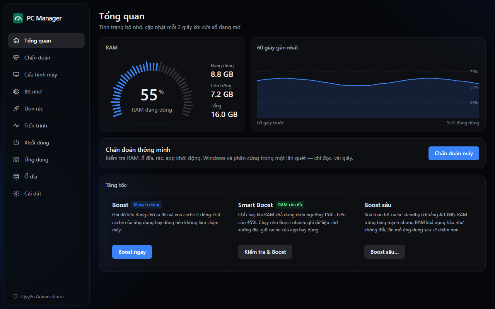
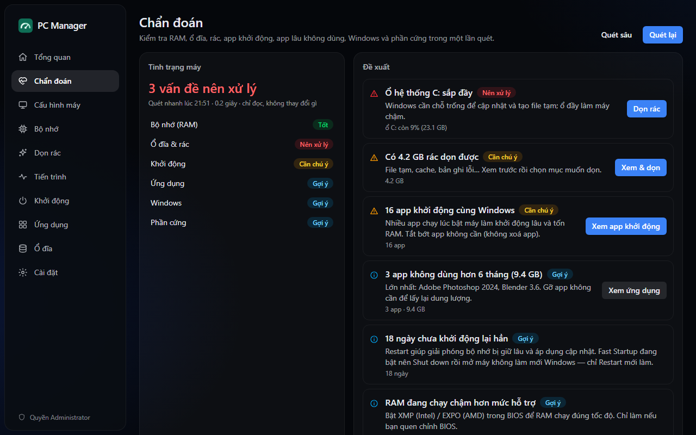
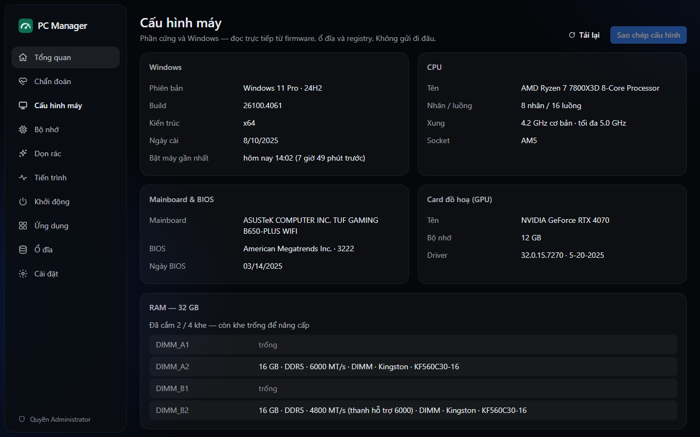
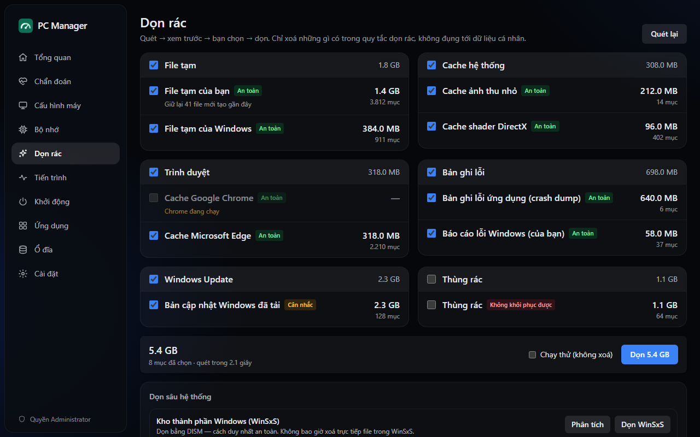
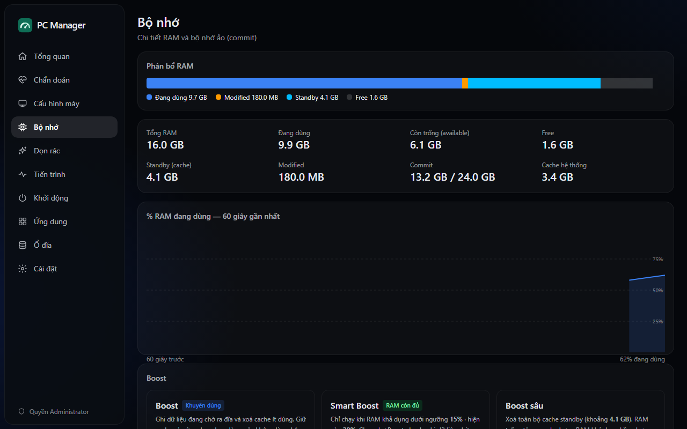
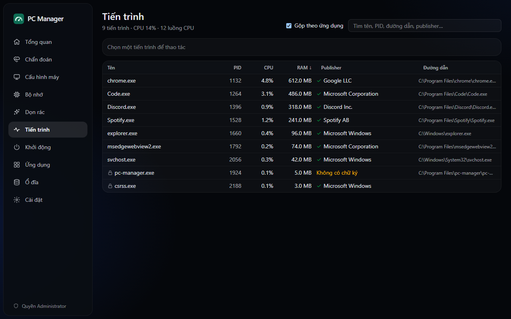
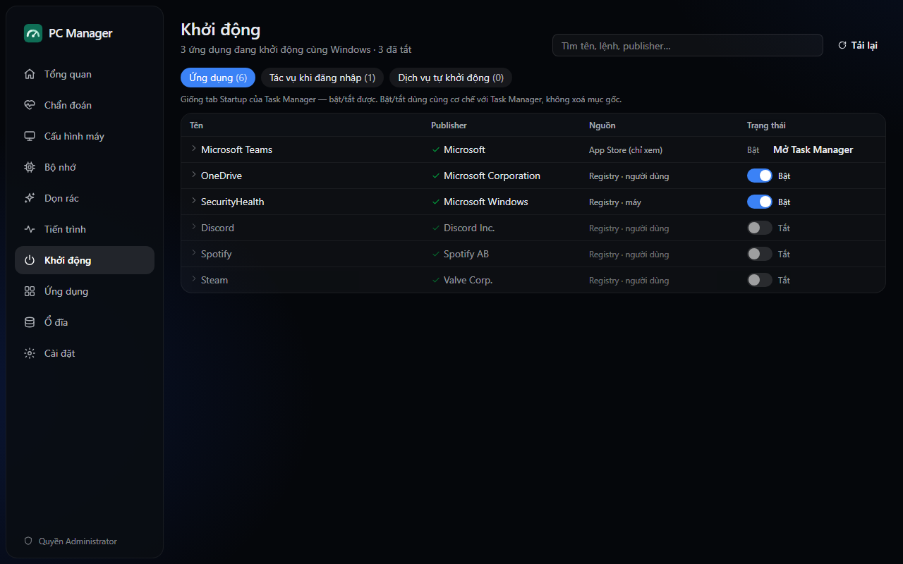
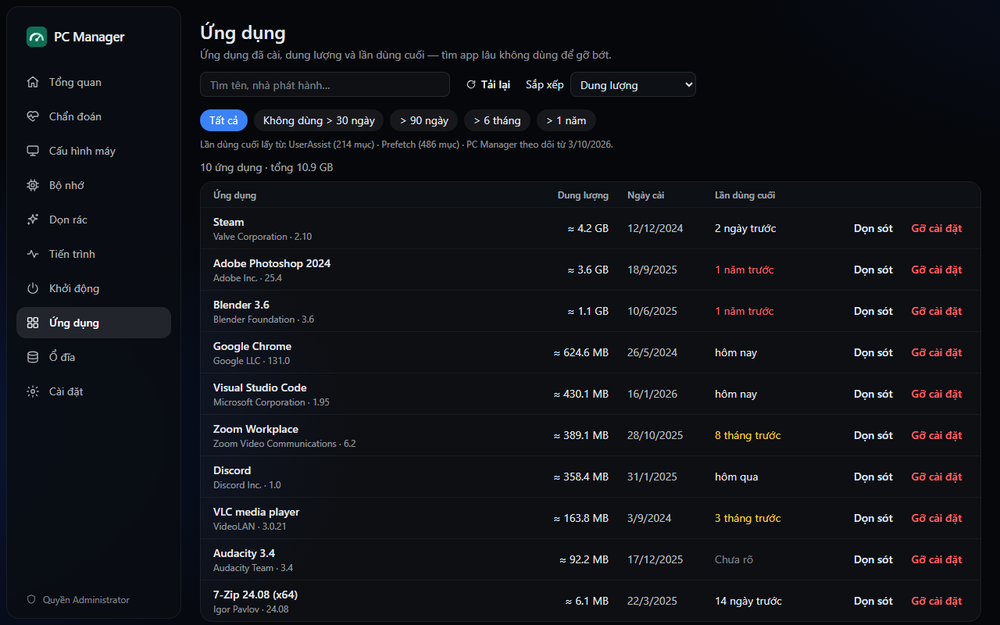
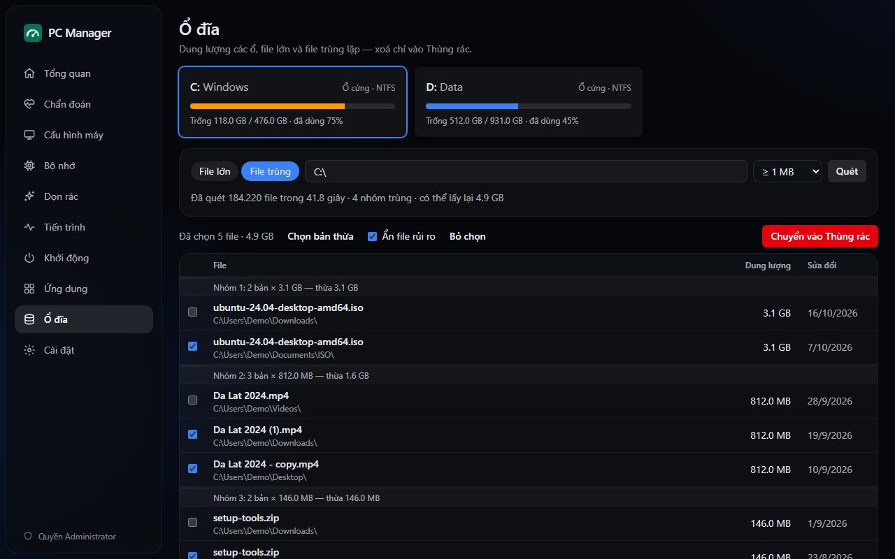
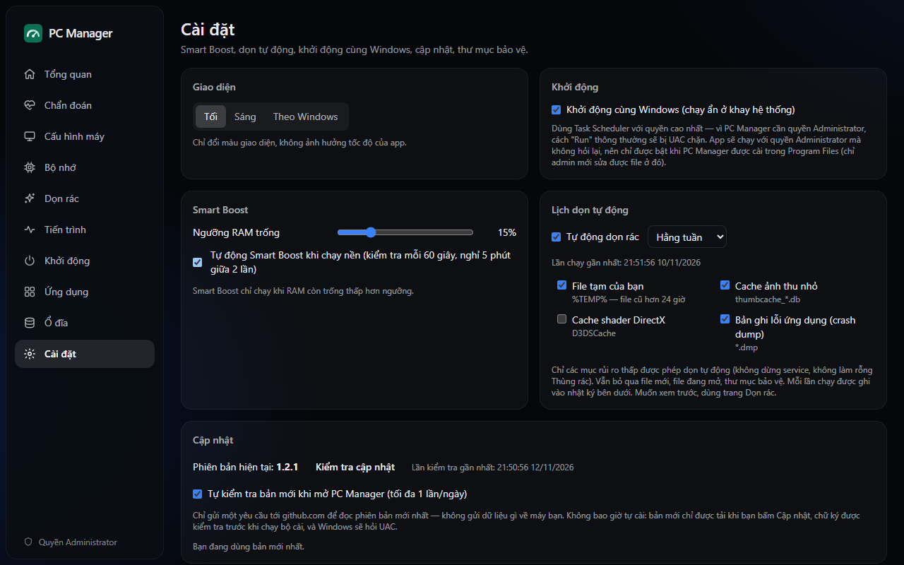

<div align="center">


# PC Manager

**A lightweight, safety-first maintenance tool for Windows 10 and 11.**

Check your PC's health in one scan, monitor memory, clean junk files, manage processes and startup apps,<br>
find unused apps, large files and duplicates — in a ~3.8 MB installer that idles at about 10 MB of RAM.

[](https://github.com/bachxuantrann/pc-manager/releases/latest)
[](https://github.com/bachxuantrann/pc-manager/actions/workflows/ci.yml)
[](#license)


**English** · [Tiếng Việt](README.vi.md)

</div>



> The app's interface is currently in Vietnamese. This documentation is available in English and Vietnamese.

## Contents

- [Highlights](#highlights)
- [Features](#features)
- [Screenshots](#screenshots)
- [Installation](#installation)
- [Administrator rights](#administrator-rights)
- [Safety](#safety)
- [How memory Boost works](#how-memory-boost-works)
- [FAQ](#faq)
- [Building from source](#building-from-source)
- [License](#license)

## Highlights

- **Lightweight.** ~3.8 MB installer. In the system tray the app uses about 10 MB of RAM;
  closing the window releases the UI engine (WebView2) entirely.
- **Safe by design.** Deletes only what fixed rules allow, always shows a preview first,
  sends anything you pick by hand to the Recycle Bin, and logs every change.
- **No admin prompt on launch.** Runs as a standard user and asks for elevation only when a
  feature actually needs it.
- **Honest.** Reports the real gain of every action instead of inflated "freed" numbers, and only
  recommends a fix when it can actually help.
- **Local and private.** No telemetry, no accounts. The only network request is an optional update
  check to github.com.

## Features

| Area | What it does |
|---|---|
| **Dashboard and memory** | Live RAM usage, available and standby memory, 60-second history; Boost, Smart Boost and Deep Boost |
| **Smart Diagnosis** | One read-only scan (about 0.2 s) of RAM, drives, junk, startup apps, unused apps, Windows state and hardware. Each finding explains *why*, with numbers, and opens the right page to fix it. Re-scan to see what improved. *Deep scan* adds a WinSxS analysis (needs administrator rights) |
| **System information** | Windows edition and build, CPU, GPU, motherboard and BIOS, every RAM slot (capacity, DDR4/DDR5, real and rated speed), drives (NVMe/SATA, SSD/HDD). One click copies the configuration; no serial numbers or machine name are collected |
| **Junk cleaner** | Temp files, thumbnail and shader caches, crash dumps, logs, browser caches (Chrome, Edge, Brave, Vivaldi, Cốc Cốc, Opera, Firefox), Windows Update cache, Recycle Bin. Preview before cleaning, dry-run mode. Deep clean of WinSxS (via DISM) and `Windows.old` (via Disk Cleanup), with real progress |
| **Processes** | CPU and memory per process, publisher (digital signature), end, suspend and resume, priority, trim working set, open file location |
| **Startup apps** | Registry, Startup folders, scheduled tasks, services and Microsoft Store apps; enable or disable the same way Task Manager does |
| **Installed apps** | Classic and Microsoft Store apps with size, install date and last-used date; filter apps you have not used for months; uninstall, then clean up leftovers |
| **Disk** | Drive usage, largest files, content-identical duplicates (BLAKE3); remove to the Recycle Bin |
| **Settings** | Dark / light / follow-Windows theme, Smart Boost threshold, scheduled cleaning, start with Windows, protected folders, in-app updates, activity log |

Long tasks (scans, cleaning, DISM) show a progress bar and **keep running when you close the
window** to the tray — reopen it and you see the progress or the result.

## Screenshots

<table>
  <tr>
    <td></td>
    <td></td>
  </tr>
  <tr>
    <td></td>
    <td></td>
  </tr>
  <tr>
    <td></td>
    <td></td>
  </tr>
  <tr>
    <td></td>
    <td></td>
  </tr>
  <tr>
    <td colspan="2"></td>
  </tr>
</table>

<sub>Screenshots use demo data, not data from a real machine. Dark theme shown; a light theme is available.</sub>

## Installation

1. Download `PC-Manager_<version>_x64-setup.exe` from the
   [latest release](https://github.com/bachxuantrann/pc-manager/releases/latest).
2. Run the installer. It installs to `Program Files` and asks for administrator approval once.
3. The installer is **self-signed**, not signed by a certificate authority that Windows trusts,
   so Microsoft Defender SmartScreen may show *"Windows protected your PC"*.
   Choose **More info → Run anyway**. Each release lists the installer's SHA-256 checksum so you
   can verify the download, or you can [build it yourself](#building-from-source).

**Requirements:** Windows 10 or 11 (x64) and the Microsoft Edge WebView2 Runtime, which ships
with Windows 11 and is downloaded automatically by the installer if missing.

**Updating:** PC Manager checks GitHub for a newer release (at most once a day, only while its
window is open; you can turn this off in *Settings*). When one exists, a banner appears; click
**Update** to download it. The installer is **signature-verified** before it runs, Windows asks for
UAC, and the app reopens afterwards. Nothing is ever installed without your click, and your
settings, activity log and *Start with Windows* option are kept. You can also just run a new
installer over the old one.

**Uninstalling:** use *Settings → Apps* like any other app. The start-with-Windows task, if
enabled, is removed as well.

## Administrator rights

| How it runs | Rights |
|---|---|
| Normal launch | Standard user, no UAC prompt |
| **Run as administrator** button (sidebar, or next to a feature that needs it) | Administrator, after a UAC prompt; reopens on the same page |
| Start with Windows (optional) | Administrator without prompting — can only be enabled when the app is installed in `Program Files` |

Features that need administrator rights: memory Boost, cleaning system locations
(`Windows\Temp`, system crash dumps, Windows Update cache), reading Prefetch, changing
machine-wide startup entries, acting on system processes, uninstalling machine-wide apps,
Deep scan and WinSxS cleanup. Everything else works without elevation.

On a work PC where you sign in as a standard user and elevate with a *different* admin account,
everything "personal" — settings, activity log, Recycle Bin, per-user apps and registry — still
belongs to the account you are signed in with, not the admin account.

## Safety

PC Manager touches files, processes, the registry and services, so every destructive path is
guarded in code. Summary below; full details in **[docs/SAFETY.md](docs/SAFETY.md)**.

- **Rule-based cleaning only.** The cleaner deletes files matching fixed rules in
  [`rules/cleaner.toml`](rules/cleaner.toml), compiled into the app. No command accepts an
  arbitrary path from the UI for deletion.
- **Scan → preview → confirm → delete**, with a dry-run mode. Diagnosis itself is read-only and
  changes nothing; its buttons only open the right page, where you still preview and confirm.
- **Never follows** symlinks, junctions or reparse points; skips locked files, files newer than
  the rule's age threshold, and files changed after the scan.
- **Hard block list:** `System32`, `SysWOW64`, `WinSxS` (cleaned only through DISM, never
  `/ResetBase`), `Prefetch`, the user-profile root, personal folders (Documents, Desktop,
  Pictures…), `Program Files`, and every drive root. You can add your own **protected folders**.
- **Recycle Bin, not permanent deletion,** for large and duplicate files and for leftovers
  after uninstalling an app. Registry keys are exported to a `.reg` backup before removal.
- **Per-user uninstallers never run as administrator.** When PC Manager has admin rights, the
  uninstaller of an app installed for your account only runs under your normal account, like
  Windows Settings does — a per-user uninstall command can be edited by any program you run, so
  running it elevated would be a privilege-escalation path.
- **Critical processes are protected** (`csrss`, `wininit`, `winlogon`, `lsass`, `smss`,
  `services`, System) and so is PC Manager itself. Disabling a startup entry never deletes the
  original.
- **Browser caches only.** Cookies, history, passwords, IndexedDB and Local Storage are never
  touched, and a browser that is running is skipped.
- **Every change is logged** locally (SQLite, newest 5,000 entries) and visible under
  *Settings → Activity log*.
- **Signed updates.** The in-app updater only runs an installer whose minisign signature matches
  the public key built into the app.
- **Tested.** 200+ automated tests, including sandboxed tests of the file-selection logic
  (junctions, locked files, young files, blocked folders, files modified after a scan),
  run on every push together with clippy and a UI build.

To report a security issue, see [SECURITY.md](SECURITY.md).

## How memory Boost works

Windows already manages memory well, so PC Manager does not promise miracles:

- **Boost (recommended)** writes pending modified pages to disk and drops *low-priority*
  standby cache. Cache of apps you use often is kept.
- **Deep Boost** drops the *entire* standby cache. "Free" memory jumps, but **available memory
  barely changes** (standby cache already counts as available) and apps load more slowly the
  next time. Use it only when you have a specific reason.
- **Smart Boost** runs only when available memory falls below a threshold (15% by default), using
  the light Boost — never the deep one, because emptying the cache when RAM is low does not give
  apps more memory. When memory is really tight, Diagnosis points you to the heaviest
  processes instead.
- Every result separates **"available memory gained"** (the real benefit) from
  **"cache cleared"**.
- **Trim working set** applies only to processes you select, never in bulk.

## FAQ

<details>
<summary><b>Why doesn't PC Manager appear under Task Manager → Startup apps?</b></summary>

Start with Windows uses a Task Scheduler task with highest privileges, because a regular
`Run` registry entry cannot start an app with administrator rights without a UAC prompt.
Task Manager does not list scheduled tasks. You will find it as **PC Manager Autostart** in
Task Scheduler, and on PC Manager's own *Startup* page.
</details>

<details>
<summary><b>Why does SmartScreen or my antivirus warn about the installer?</b></summary>

The installer is self-signed. Removing that warning requires a commercial code-signing
certificate. Compare the SHA-256 checksum on the release page, or build from source.
</details>

<details>
<summary><b>Diagnosis keeps suggesting "clean WinSxS", but cleaning frees nothing. Why?</b></summary>

DISM often reports "cleanup recommended" even when `StartComponentCleanup` has nothing left it is
allowed to remove — for example packages Windows still holds, or a pending restart. PC Manager
remembers the outcome of earlier cleanups and only recommends WinSxS cleanup when it can actually
reclaim space; while Windows is waiting for a restart it tells you to restart first.
</details>

<details>
<summary><b>How much memory does PC Manager itself use?</b></summary>

About 10 MB while running in the tray. With the window open, add roughly 100 MB for the WebView2
engine that renders the UI; it releases memory when the window loses focus and is shut down
completely when you close the window. Measurements per release are in
[docs/PERF.md](docs/PERF.md).
</details>

<details>
<summary><b>The app closed unexpectedly. How do I report it?</b></summary>

PC Manager records unexpected errors in `%APPDATA%\com.pcmanager.app\logs\crash.log`.
[Open an issue](https://github.com/bachxuantrann/pc-manager/issues/new) with that file, your
Windows version and what you were doing.
</details>

<details>
<summary><b>Does it work on macOS or Linux?</b></summary>

Not currently. The system features rely on Windows APIs.
</details>

## Building from source

Requires Node.js 22+, Rust (stable, `x86_64-pc-windows-msvc`), Visual Studio 2022 Build Tools
(C++ workload and Windows SDK) and WebView2.

```powershell
git clone https://github.com/bachxuantrann/pc-manager.git
cd pc-manager
npm install
npm run tauri build   # installer: src-tauri/target/release/bundle/nsis/
```

You can browse the interface without the backend using demo data:
`npm run dev`, then open `http://localhost:1420/?demo&page=diagnosis`.

See **[CONTRIBUTING.md](CONTRIBUTING.md)** for development, tests, CI and releases, and
[`docs/PLAN.md`](docs/PLAN.md) for the improvement plan.

Built with [Tauri 2](https://tauri.app), [React](https://react.dev), [Rust](https://www.rust-lang.org)
and [windows-rs](https://github.com/microsoft/windows-rs).

## License

Licensed under either of

- Apache License, Version 2.0 ([LICENSE-APACHE](LICENSE-APACHE))
- MIT license ([LICENSE-MIT](LICENSE-MIT))

at your option.
