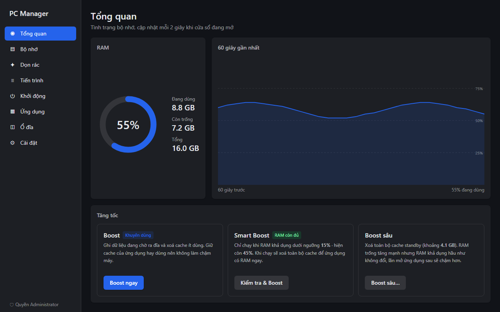
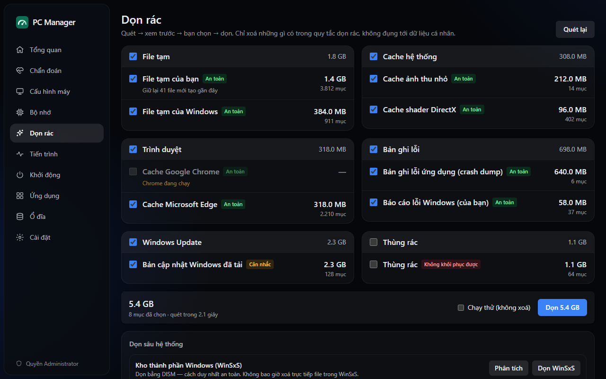
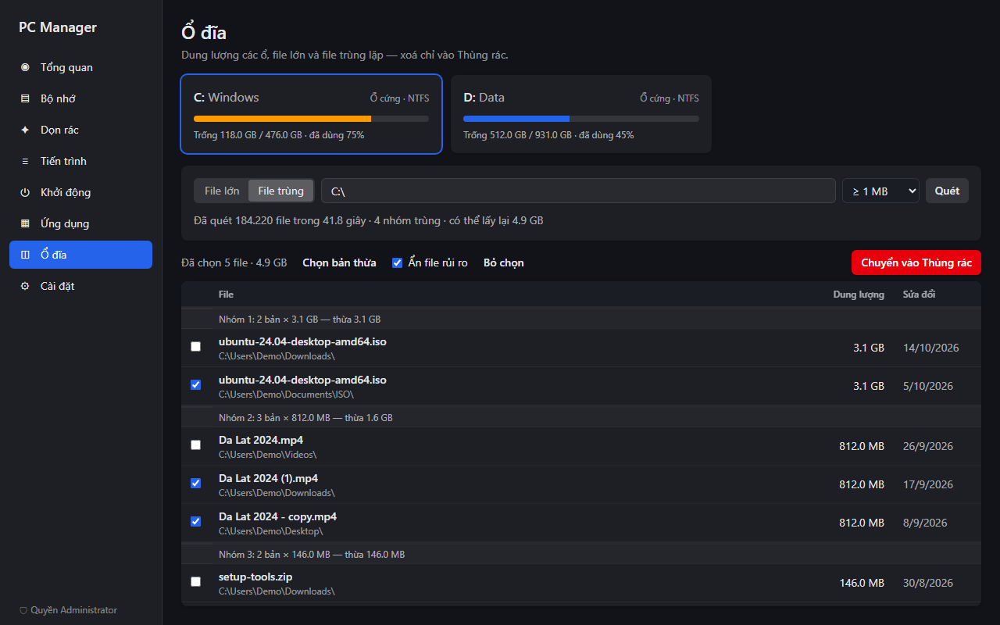
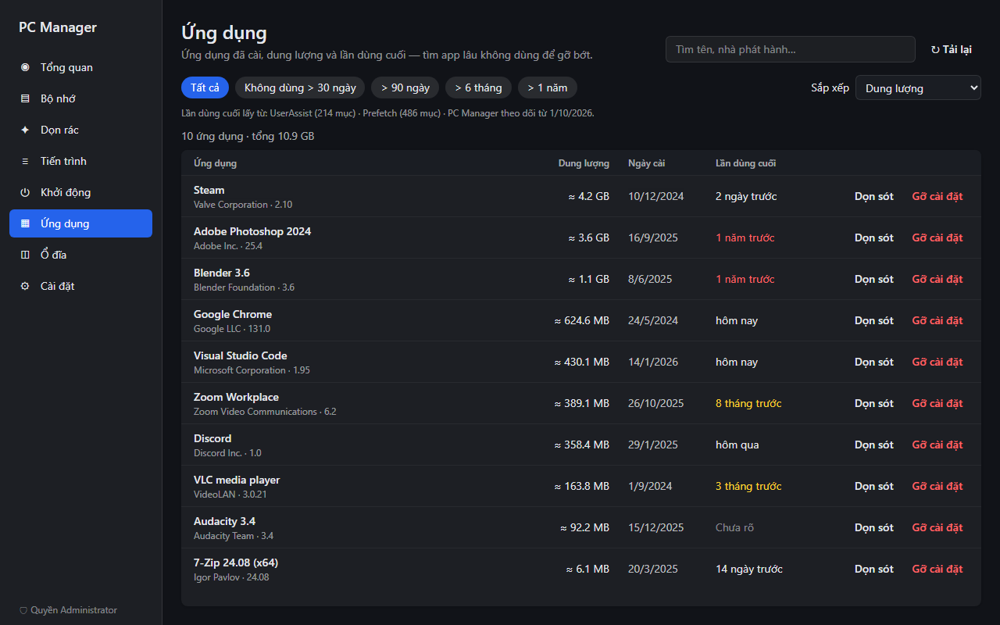
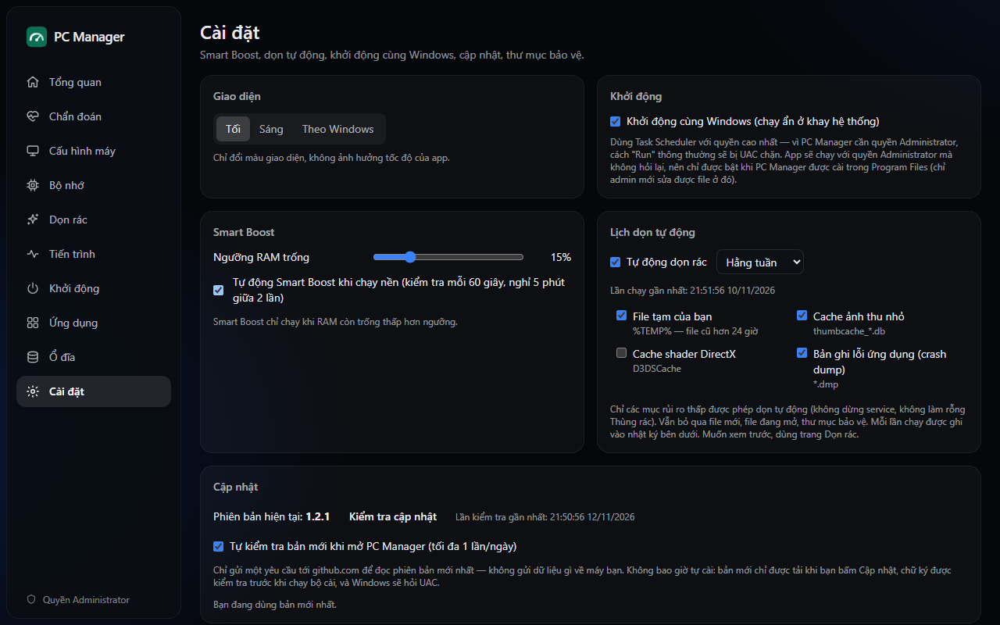

<div align="center">


# PC Manager

**Công cụ chăm sóc máy Windows 10/11 nhẹ, đặt an toàn lên hàng đầu.**

Theo dõi RAM, dọn rác, quản lý tiến trình và ứng dụng khởi động, tìm app lâu không dùng,<br>
file lớn và file trùng — bộ cài 2.5 MB, chạy ngầm chỉ tốn vài MB RAM.

[](https://github.com/bachxuantrann/pc-manager/releases/latest)
[](https://github.com/bachxuantrann/pc-manager/actions/workflows/ci.yml)
[](#giấy-phép)


[English](README.md) · **Tiếng Việt** · [简体中文](README.zh-CN.md) · [日本語](README.ja.md)

</div>



## Mục lục

- [Điểm nổi bật](#điểm-nổi-bật)
- [Tính năng](#tính-năng)
- [Cài đặt](#cài-đặt)
- [Quyền Administrator](#quyền-administrator)
- [An toàn](#an-toàn)
- [Boost RAM hoạt động thế nào](#boost-ram-hoạt-động-thế-nào)
- [Câu hỏi thường gặp](#câu-hỏi-thường-gặp)
- [Build từ mã nguồn](#build-từ-mã-nguồn)
- [Giấy phép](#giấy-phép)

## Điểm nổi bật

- **Nhẹ.** Bộ cài ~2.5 MB. Chạy ngầm ở khay hệ thống chỉ khoảng 2–15 MB RAM; đóng cửa sổ là
  giải phóng hẳn phần giao diện.
- **An toàn ngay từ thiết kế.** Chỉ xoá theo quy tắc cố định, luôn cho xem trước, file bạn tự chọn
  chỉ vào Thùng rác, mọi thay đổi đều được ghi nhật ký.
- **Mở không hỏi UAC.** Chạy với quyền thường, chỉ xin quyền admin khi tính năng thật sự cần.
- **Trung thực.** Báo đúng lợi ích thật của từng thao tác, không thổi phồng con số "đã giải phóng".

## Tính năng

| Mục | Làm được gì |
|---|---|
| **Tổng quan và bộ nhớ** | RAM đang dùng, khả dụng, standby, biểu đồ 60 giây; Boost, Smart Boost và Boost sâu |
| **Dọn rác** | File tạm, cache trình duyệt, crash dump, log, cache Windows Update, Thùng rác. Xem trước rồi mới dọn, có chạy thử. Dọn sâu WinSxS (qua DISM) và `Windows.old` (qua Disk Cleanup) |
| **Tiến trình** | CPU và RAM từng tiến trình, nhà phát hành (chữ ký số), kết thúc, tạm dừng/tiếp tục, ưu tiên, thu gọn bộ nhớ, mở vị trí file |
| **Khởi động** | Registry, thư mục Startup, scheduled task và service; bật/tắt theo cùng cơ chế với Task Manager |
| **Ứng dụng** | Dung lượng, ngày cài, lần dùng cuối; lọc app lâu không dùng; gỡ cài đặt rồi dọn phần còn sót |
| **Ổ đĩa** | Dung lượng các ổ, file lớn nhất, file trùng nội dung (BLAKE3); chuyển vào Thùng rác |
| **Cài đặt** | Ngưỡng Smart Boost, lịch dọn tự động, khởi động cùng Windows, thư mục bảo vệ, nhật ký thao tác |

<table>
  <tr>
    <td></td>
    <td></td>
  </tr>
  <tr>
    <td></td>
    <td></td>
  </tr>
</table>

<sub>Ảnh chụp dùng dữ liệu demo, không phải dữ liệu máy thật.</sub>

## Cài đặt

1. Tải `PC-Manager_<phiên bản>_x64-setup.exe` ở
   [bản phát hành mới nhất](https://github.com/bachxuantrann/pc-manager/releases/latest).
2. Chạy bộ cài. App được cài vào `Program Files`, Windows hỏi xác nhận quyền admin một lần.
3. Bộ cài được **ký bằng chứng chỉ tự ký**, không phải chứng chỉ do nhà cung cấp được Windows tin
   cậy, nên Microsoft Defender SmartScreen có thể hiện *"Windows protected your PC"*.
   Bấm **More info → Run anyway**. Mỗi bản phát hành có mã SHA-256 để bạn kiểm tra file tải về,
   hoặc bạn có thể [tự build](#build-từ-mã-nguồn).

**Yêu cầu:** Windows 10 hoặc 11 (x64) và Microsoft Edge WebView2 Runtime (có sẵn trên Windows 11;
bộ cài tự tải nếu thiếu).

**Cập nhật:** chạy bộ cài mới đè lên bản cũ; cài đặt và nhật ký được giữ nguyên.
**Gỡ cài đặt:** qua *Settings → Apps* như mọi app khác. Task khởi động cùng Windows (nếu đã bật)
được xoá theo.

## Quyền Administrator

| Cách chạy | Quyền |
|---|---|
| Mở app bình thường | Quyền thường, không hỏi UAC |
| Nút **Chạy với quyền Administrator** (ở sidebar hoặc cạnh tính năng cần quyền) | Admin, sau khi xác nhận UAC; mở lại đúng trang đang xem |
| Khởi động cùng Windows (tuỳ chọn) | Admin, không hỏi lại — chỉ bật được khi app cài trong `Program Files` |

Cần quyền admin cho: Boost RAM, dọn vị trí hệ thống (`Windows\Temp`, crash dump hệ thống, cache
Windows Update), đọc Prefetch, sửa mục khởi động của cả máy, thao tác tiến trình hệ thống, gỡ app
cài cho cả máy, dọn WinSxS. Các phần khác dùng được không cần nâng quyền.

## An toàn

PC Manager đụng tới file, tiến trình, registry và service, nên mọi đường dẫn tới thao tác xoá đều
được kiểm soát trong code. Tóm tắt dưới đây; chi tiết ở **[docs/AN-TOAN.md](docs/AN-TOAN.md)**.

- **Chỉ dọn theo quy tắc.** Chỉ xoá file khớp quy tắc cố định trong
  [`rules/cleaner.toml`](rules/cleaner.toml), được nhúng vào app lúc build. Không có lệnh nào nhận
  đường dẫn tuỳ ý từ giao diện để xoá.
- **Quét → xem trước → xác nhận → xoá**, có chế độ chạy thử.
- **Không đi theo** symlink, junction, reparse point; bỏ qua file đang khoá, file mới hơn ngưỡng tuổi
  của quy tắc, và file thay đổi sau khi quét.
- **Danh sách cấm cứng:** `System32`, `SysWOW64`, `WinSxS` (chỉ dọn qua DISM), `Prefetch`, gốc thư mục
  người dùng, thư mục cá nhân (Documents, Desktop, Pictures…), `Program Files` và gốc mọi ổ đĩa.
  Bạn có thể tự thêm **thư mục bảo vệ**.
- **Vào Thùng rác, không xoá vĩnh viễn** với file lớn, file trùng và phần còn sót sau khi gỡ app.
  Key registry được sao lưu ra file `.reg` trước khi xoá.
- **Bảo vệ tiến trình quan trọng** (`csrss`, `wininit`, `winlogon`, `lsass`, `smss`, `services`,
  System). Tắt mục khởi động không bao giờ xoá mục gốc.
- **Mọi thay đổi được ghi nhật ký** trên máy, xem ở *Cài đặt → Nhật ký thao tác*.
- **Có kiểm thử.** Hơn 140 test tự động, gồm test hộp cát cho logic chọn file xoá (junction, file
  khoá, file mới, thư mục cấm, file đổi sau khi quét), chạy ở mỗi lần push.

Báo lỗi bảo mật: xem [SECURITY.md](SECURITY.md).

## Boost RAM hoạt động thế nào

Windows vốn quản lý bộ nhớ khá tốt, nên PC Manager không hứa "tăng tốc thần kỳ":

- **Boost (khuyên dùng)** ghi các trang bộ nhớ đang chờ ra đĩa và xoá cache standby *ưu tiên thấp*.
  Cache của app hay dùng được giữ lại.
- **Boost sâu** xoá *toàn bộ* cache standby. RAM "trống" tăng mạnh nhưng **RAM khả dụng gần như
  không đổi** (cache standby vốn đã được tính là khả dụng), và app mở lần sau sẽ chậm hơn.
  Chỉ dùng khi có lý do cụ thể.
- **Smart Boost** chỉ chạy khi RAM khả dụng xuống dưới ngưỡng (mặc định 15%).
- Mọi kết quả tách riêng **"RAM khả dụng tăng thêm"** (lợi ích thật) và **"cache đã xoá"**.
- **Thu gọn bộ nhớ** chỉ áp dụng cho tiến trình bạn chọn, không làm hàng loạt.

## Câu hỏi thường gặp

<details>
<summary><b>Vì sao PC Manager không có trong Task Manager → Startup apps?</b></summary>

Khởi động cùng Windows dùng một task trong Task Scheduler với quyền cao nhất, vì mục `Run` thông
thường không thể chạy app với quyền admin mà không hỏi UAC. Task Manager không hiện scheduled task.
Bạn sẽ thấy task **PC Manager Autostart** trong Task Scheduler và trong trang *Khởi động* của chính
PC Manager.
</details>

<details>
<summary><b>Vì sao SmartScreen hoặc phần mềm diệt virus cảnh báo bộ cài?</b></summary>

Bộ cài được ký tự ký. Muốn hết cảnh báo cần chứng chỉ ký mã thương mại. Bạn có thể đối chiếu mã
SHA-256 trên trang phát hành, hoặc tự build từ mã nguồn.
</details>

<details>
<summary><b>Bản thân PC Manager tốn bao nhiêu RAM?</b></summary>

Khoảng 2–15 MB khi chạy ngầm ở khay. Khi mở cửa sổ khoảng 75–80 MB, phần lớn là engine WebView2 dùng
để hiển thị giao diện; engine nhả bộ nhớ khi cửa sổ không được dùng và tắt hẳn khi bạn đóng cửa sổ.
</details>

<details>
<summary><b>Có chạy trên macOS hoặc Linux không?</b></summary>

Hiện chưa. Các tính năng hệ thống dựa trên API của Windows.
</details>

## Build từ mã nguồn

Cần Node.js 22+, Rust (stable, `x86_64-pc-windows-msvc`), Visual Studio 2022 Build Tools (C++ và
Windows SDK) và WebView2.

```powershell
git clone https://github.com/bachxuantrann/pc-manager.git
cd pc-manager
npm install
npm run tauri build   # bộ cài: src-tauri/target/release/bundle/nsis/
```

Hướng dẫn phát triển, kiểm thử, CI và phát hành: **[CONTRIBUTING.md](CONTRIBUTING.md)**.

Xây dựng bằng [Tauri 2](https://tauri.app), [React](https://react.dev), [Rust](https://www.rust-lang.org)
và [windows-rs](https://github.com/microsoft/windows-rs).

## Giấy phép

Phát hành theo một trong hai giấy phép, tuỳ bạn chọn:

- Apache License, Version 2.0 ([LICENSE-APACHE](LICENSE-APACHE))
- MIT license ([LICENSE-MIT](LICENSE-MIT))
