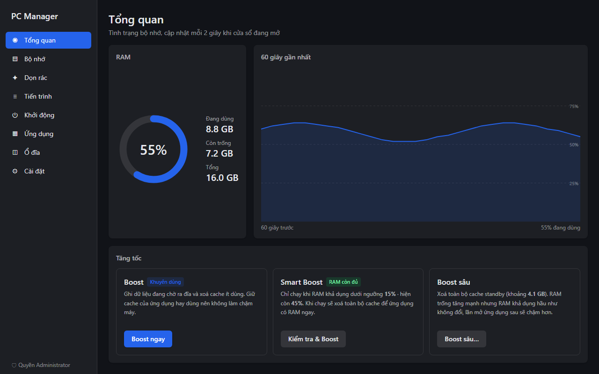
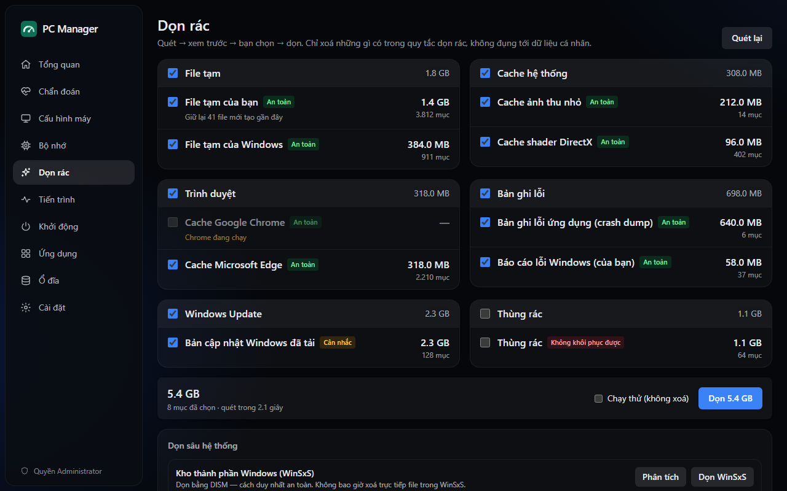
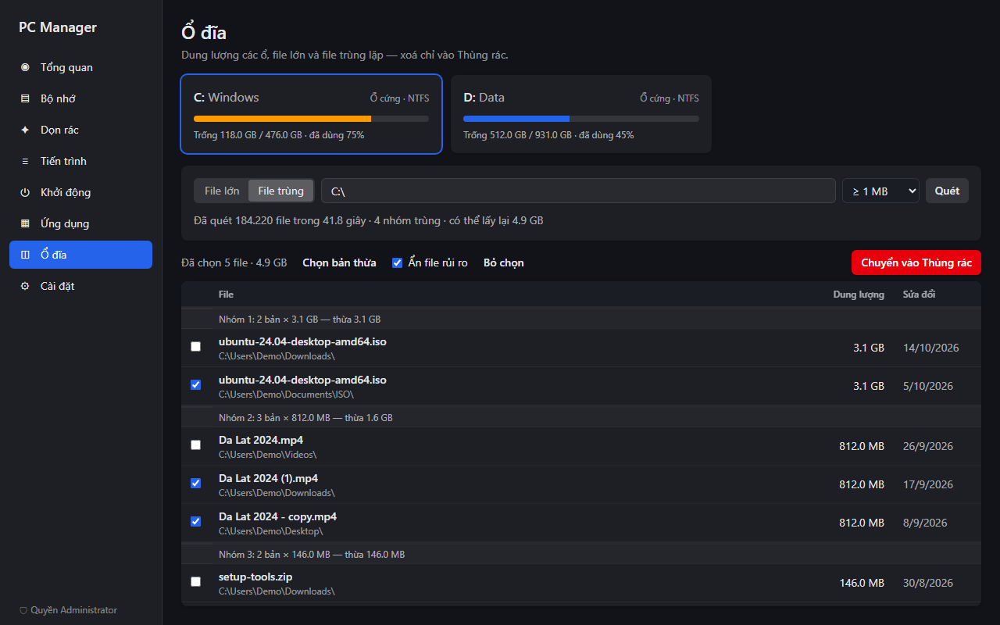
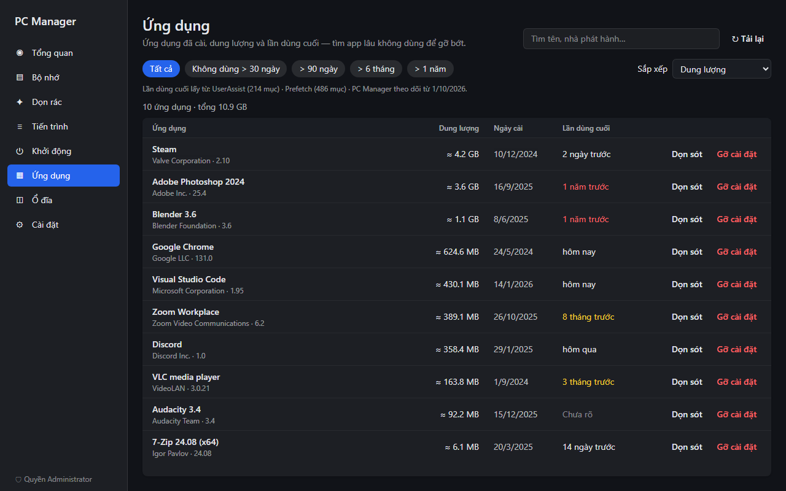
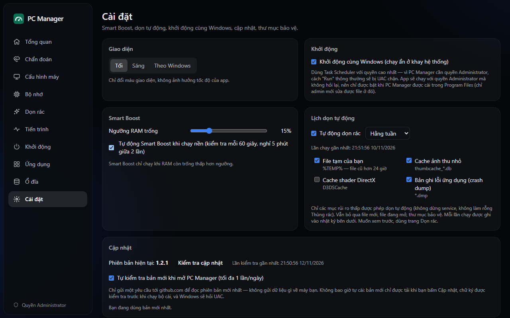

<div align="center">


# PC Manager

**轻量、以安全为先的 Windows 10/11 系统维护工具。**

监控内存、清理垃圾文件、管理进程和启动项、查找长期未用的应用、<br>
大文件和重复文件——安装包仅 2.5 MB，后台运行只占用几 MB 内存。

[](https://github.com/bachxuantrann/pc-manager/releases/latest)
[](https://github.com/bachxuantrann/pc-manager/actions/workflows/ci.yml)
[](#许可证)


[English](README.md) · [Tiếng Việt](README.vi.md) · **简体中文** · [日本語](README.ja.md)

</div>



> 界面目前为越南语。本页面为说明文档的中文翻译。

## 目录

- [亮点](#亮点)
- [功能](#功能)
- [安装](#安装)
- [管理员权限](#管理员权限)
- [安全](#安全)
- [内存加速的原理](#内存加速的原理)
- [常见问题](#常见问题)
- [从源码构建](#从源码构建)
- [许可证](#许可证)

## 亮点

- **轻量。** 安装包约 2.5 MB。在系统托盘中运行时仅占用约 2–15 MB 内存；关闭窗口即完全释放界面引擎。
- **安全设计。** 只按固定规则删除文件，始终先预览；手动选择的文件只会移入回收站；所有更改都会记录日志。
- **启动时不弹 UAC。** 以普通用户权限运行，只有功能确实需要时才请求管理员权限。
- **如实报告。** 显示每项操作的真实效果，而不是夸大的"已释放"数字。

## 功能

| 模块 | 说明 |
|---|---|
| **概览与内存** | 实时内存占用、可用内存、备用（standby）内存、60 秒曲线；加速、智能加速、深度加速 |
| **垃圾清理** | 临时文件、浏览器缓存、崩溃转储、日志、Windows 更新缓存、回收站。先预览后清理，支持试运行。通过 DISM 清理 WinSxS，通过磁盘清理删除 `Windows.old` |
| **进程** | 每个进程的 CPU 和内存、发布者（数字签名）、结束、挂起/恢复、优先级、裁剪工作集、打开文件位置 |
| **启动项** | 注册表、启动文件夹、计划任务和服务；启用/禁用方式与任务管理器相同 |
| **已安装应用** | 大小、安装日期、最后使用时间；筛选数月未用的应用；卸载后清理残留 |
| **磁盘** | 各驱动器用量、最大的文件、内容相同的重复文件（BLAKE3）；移入回收站 |
| **设置** | 智能加速阈值、定时清理、开机启动、受保护文件夹、操作日志 |

<table>
  <tr>
    <td></td>
    <td></td>
  </tr>
  <tr>
    <td></td>
    <td></td>
  </tr>
</table>

<sub>截图使用演示数据，并非真实电脑上的数据。</sub>

## 安装

1. 从[最新版本](https://github.com/bachxuantrann/pc-manager/releases/latest)下载
   `PC-Manager_<版本>_x64-setup.exe`。
2. 运行安装程序。程序安装到 `Program Files`，需要确认一次管理员权限。
3. 安装程序使用**自签名证书**签名，而不是 Windows 信任的证书颁发机构，因此 Microsoft Defender
   SmartScreen 可能提示 *"Windows protected your PC"*。请选择 **More info → Run anyway**。
   每个版本都提供安装包的 SHA-256 校验值，也可以[自行构建](#从源码构建)。

**系统要求：** Windows 10 或 11（x64），以及 Microsoft Edge WebView2 Runtime（Windows 11 自带；
缺少时安装程序会自动下载）。

**更新：** 直接运行新版安装程序覆盖安装，设置和日志会保留。
**卸载：** 与其他应用一样在 *设置 → 应用* 中卸载。若启用了开机启动，相应任务也会一并删除。

## 管理员权限

| 运行方式 | 权限 |
|---|---|
| 正常启动 | 普通用户，不弹 UAC |
| **以管理员身份运行**按钮（侧边栏，或需要权限的功能旁） | 确认 UAC 后获得管理员权限，并回到当前页面 |
| 开机启动（可选） | 管理员权限且不再提示——仅当应用安装在 `Program Files` 时才能启用 |

需要管理员权限的功能：内存加速、清理系统位置（`Windows\Temp`、系统崩溃转储、Windows 更新缓存）、
读取 Prefetch、修改全机启动项、操作系统进程、卸载为所有用户安装的应用、清理 WinSxS。
其余功能无需提权即可使用。

## 安全

PC Manager 会操作文件、进程、注册表和服务，因此所有删除路径都在代码中受到保护。
以下为摘要，完整说明见 **[docs/SAFETY.md](docs/SAFETY.md)**（英文）。

- **只按规则清理。** 清理器只删除与 [`rules/cleaner.toml`](rules/cleaner.toml) 中固定规则匹配的文件，
  规则在构建时编译进程序。没有任何命令会接受界面传来的任意路径进行删除。
- **扫描 → 预览 → 确认 → 删除**，并支持试运行。
- **从不跟随**符号链接、目录联接或重解析点；跳过被锁定的文件、比规则年龄阈值更新的文件，以及扫描后被修改的文件。
- **硬性禁止列表：** `System32`、`SysWOW64`、`WinSxS`（只通过 DISM 清理）、`Prefetch`、用户目录根、
  个人文件夹（文档、桌面、图片……）、`Program Files` 以及所有驱动器根目录。你还可以添加自己的**受保护文件夹**。
- **移入回收站而非永久删除：** 适用于大文件、重复文件以及卸载应用后的残留。删除注册表项前会导出 `.reg` 备份。
- **保护关键进程**（`csrss`、`wininit`、`winlogon`、`lsass`、`smss`、`services`、System）。
  禁用启动项不会删除原始条目。
- **所有更改都记录在本地日志中**，可在 *设置 → 操作日志* 查看。
- **有测试保障。** 140 多个自动化测试，包括针对删除文件选择逻辑的沙箱测试（目录联接、锁定文件、新文件、
  禁止目录、扫描后被修改的文件），每次推送都会运行。

报告安全问题请参阅 [SECURITY.md](SECURITY.md)。

## 内存加速的原理

Windows 本身的内存管理已经很好，所以 PC Manager 不承诺"神奇提速"：

- **加速（推荐）** 将待写入的已修改页写回磁盘，并清除*低优先级*的备用缓存，常用应用的缓存会保留。
- **深度加速** 清除*全部*备用缓存。"空闲"内存会大幅增加，但**可用内存几乎不变**（备用缓存本来就计入可用内存），
  而且下次打开应用会更慢。仅在有明确理由时使用。
- **智能加速** 仅在可用内存低于阈值（默认 15%）时运行。
- 每次结果都分别显示**"增加的可用内存"**（真实收益）和**"清除的缓存"**。
- **裁剪工作集** 只作用于你选中的进程，从不批量执行。

## 常见问题

<details>
<summary><b>为什么任务管理器的"启动应用"里看不到 PC Manager？</b></summary>

开机启动使用的是具有最高权限的计划任务，因为普通的 `Run` 注册表项无法在不弹 UAC 的情况下以管理员身份启动应用。
任务管理器不显示计划任务。你可以在任务计划程序中找到 **PC Manager Autostart**，也可以在 PC Manager 自己的启动项页面看到它。
</details>

<details>
<summary><b>为什么 SmartScreen 或杀毒软件会提示安装程序？</b></summary>

安装程序为自签名。要消除该提示需要商业代码签名证书。可以核对发布页面上的 SHA-256 校验值，或从源码构建。
</details>

<details>
<summary><b>PC Manager 本身占用多少内存？</b></summary>

在托盘中运行时约 2–15 MB。打开窗口时约 75–80 MB，主要是用于显示界面的 WebView2 引擎；
窗口失去焦点时会释放内存，关闭窗口后引擎会完全退出。
</details>

<details>
<summary><b>应用意外关闭，如何报告？</b></summary>

PC Manager 会把意外错误记录在 `%APPDATA%\com.pcmanager.app\logs\crash.log`。
请[提交 issue](https://github.com/bachxuantrann/pc-manager/issues/new)，附上该文件、Windows 版本以及当时的操作。
</details>

<details>
<summary><b>支持 macOS 或 Linux 吗？</b></summary>

目前不支持。系统功能依赖 Windows API。
</details>

## 从源码构建

需要 Node.js 22+、Rust（stable，`x86_64-pc-windows-msvc`）、Visual Studio 2022 Build Tools
（C++ 工作负载和 Windows SDK）以及 WebView2。

```powershell
git clone https://github.com/bachxuantrann/pc-manager.git
cd pc-manager
npm install
npm run tauri build   # 安装包：src-tauri/target/release/bundle/nsis/
```

开发、测试、CI 和发布说明见 **[CONTRIBUTING.md](CONTRIBUTING.md)**（英文）。

基于 [Tauri 2](https://tauri.app)、[React](https://react.dev)、[Rust](https://www.rust-lang.org)
和 [windows-rs](https://github.com/microsoft/windows-rs) 构建。

## 许可证

可任选以下其一：

- Apache License, Version 2.0（[LICENSE-APACHE](LICENSE-APACHE)）
- MIT license（[LICENSE-MIT](LICENSE-MIT)）
